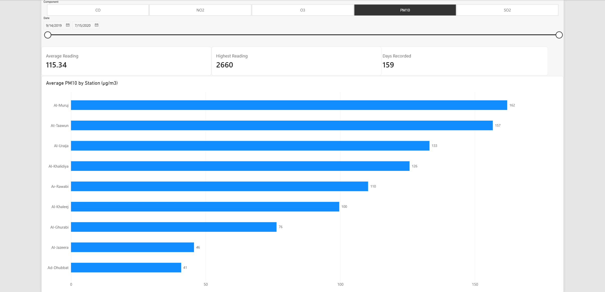
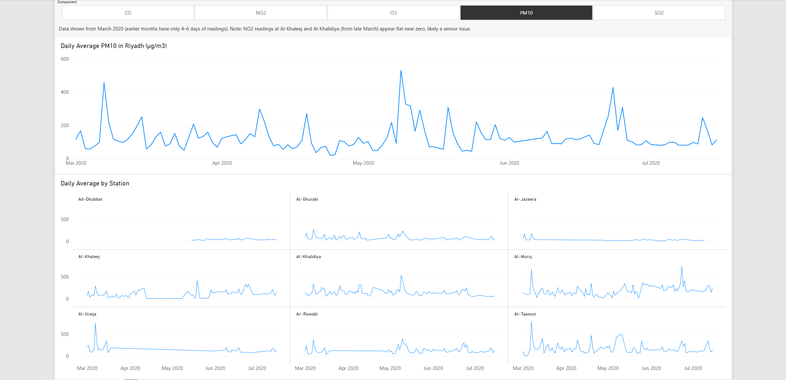
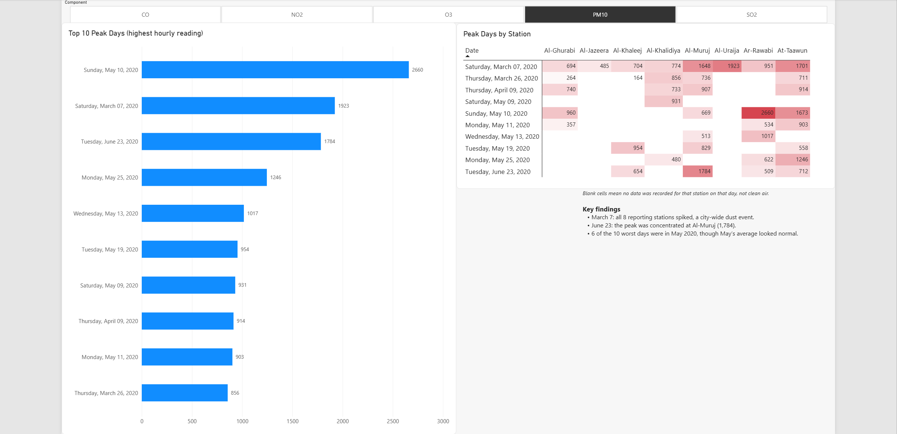
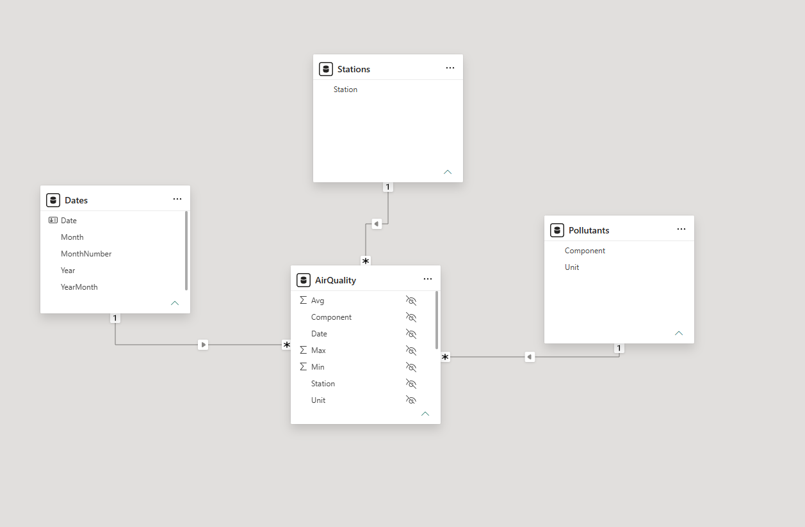

# Riyadh Air Quality Dashboard (Power BI)

An interactive Power BI dashboard analyzing daily air pollution readings from 9 monitoring stations in Riyadh (2019–2020), covering 5 pollutants: PM10, NO2, O3, SO2 and CO.



## Questions this dashboard answers

1. **Which stations record the highest pollution?**
2. **How did pollution change over time?** Are there clear spikes or trends?
3. **Which days were the worst, and were they city-wide events or local to one station?**

## Key findings (PM10)

- **Al-Muruj** has the highest average PM10 (162 µg/m³), about 4× higher than **Ad-Dhubbat** (41 µg/m³).
- **March 7, 2020:** all 8 reporting stations spiked on the same day, pointing to a city-wide dust event.
- **June 23, 2020:** the peak was concentrated at Al-Muruj (1,784 µg/m³), so it was a local event.
- **6 of the 10 worst days were in May 2020**, even though May's monthly average looked normal. Monthly averages hide short, extreme events.
- The highest single hourly reading was **2,660 µg/m³** on May 10, 2020.

## Dashboard pages

| Page | What it shows |
|---|---|
| **Stations** | Average reading per station, plus KPI cards (average, highest reading, days recorded) |
| **Trends** | Daily city-wide average over time, plus a small-multiples chart per station |
| **Peak Days** | Top 10 days by highest hourly reading, and a heatmap showing which stations drove each peak |

A pollutant slicer at the top of each page switches all visuals between PM10, NO2, O3, SO2 and CO. Titles and units update automatically.




## Data preparation (Power Query)

- Imported the semicolon-separated CSV with UTF-8 encoding.
- Profiled columns on the **entire dataset** (not just the first 1,000 rows) to find empty columns and all category values.
- Removed constant and empty columns (City, Periodicity, Quarter).
- Pivoted the `Indicator` column into separate **Min / Avg / Max** columns.
- Added a validation check (`Min <= Avg <= Max`) and removed the 5 rows that failed it.

## Data model

A star schema with one fact table and three dimension tables, all connected with one-to-many relationships:

- **AirQuality** (fact): one row per station, pollutant and day
- **Stations**, **Pollutants** (with units), **Dates** (a calendar table marked as the date table)



## DAX measures

```DAX
Average Reading = IF(HASONEVALUE(Pollutants[Component]), AVERAGE(AirQuality[Avg]))
Highest Reading = IF(HASONEVALUE(Pollutants[Component]), MAX(AirQuality[Max]))
Days Recorded   = DISTINCTCOUNT(AirQuality[Date])
Station Chart Title =
    "Average " & SELECTEDVALUE(Pollutants[Component]) &
    " by Station (" & SELECTEDVALUE(Pollutants[Unit]) & ")"
```

`HASONEVALUE` prevents averaging pollutants with different units together (for example, µg/m³ and ppb).

## Data quality notes

- **Coverage is uneven.** Stations have different numbers of recorded days, and months before March 2020 have only 4–6 days of readings, so the Trends page starts in March 2020.
- **Blank cells in the heatmap mean missing data**, not clean air.
- **NO2 readings at Al-Khaleej, and at Al-Khalidiya from late March, stay flat near zero**, which suggests a sensor issue rather than real values.

## Tools

Power BI Desktop · Power Query · DAX

## Files

```
├── Riyadh-Air-Quality.pbix   Power BI report
├── data/air-quality.csv      Source data
└── images/                   Screenshots
```

To explore it, download `Riyadh-Air-Quality.pbix` and open it in [Power BI Desktop](https://www.microsoft.com/power-platform/products/power-bi/desktop) (free).

## Data source

Riyadh air quality readings, 2019–2020. Source: [KAPSARC Data Portal – Air Quality](https://data.kapsarc.org/explore/assets/air-quality/)
